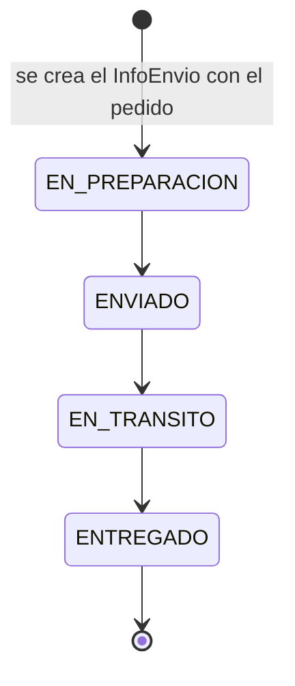

# Diseño de `InfoEnvio` y estados de envío (RF-027, RF-028, RF-029)

Módulo MOD-05 (Envíos). Documento de diseño preparado en Sprint 3 para que Sprint 4 conecte
los endpoints sobre `Pedido` sin rediseñar nada.

Fuentes: DDS v1.2 §3 (MOD-05), §4 (modelo de datos), §5.2 (códigos HTTP), §5.3 (formato de
error); ERS v1.2 (RF-027, RF-028, RF-029, matriz de roles 4.1, estados 4.2).

## 1. Estado y dependencias

| Pieza | Estado |
| --- | --- |
| Validación de transiciones (`validarTransicionEstado`) | Implementada y testeada en `backend/src/services/envio.service.js` (función pura). |
| Modelo `InfoEnvio` y enum `EstadoEnvio` | **No existen en `sprint-3`** (decisión de la tarjeta: no se crea el modelo hasta que exista `Pedido`). **Ya están en `sprint-4`** (`backend/prisma/schema.prisma`), con los campos de esta propuesta. |
| Endpoints `PUT .../estado-envio` y `GET .../seguimiento` | Sin implementar: cuelgan de `/pedidos/:id`, y `Pedido` (MOD-06) llega en Sprint 4. DDS §4.1: `Pedido (1)───(1) InfoEnvio`. **Ya implementados en `sprint-4`** (`pedido.routes.js`). |
| Modelo `HistorialEstadoEnvio` | **Ya existe en `sprint-4`** (RF-028 y RF-029): ver sección 5. |

Por eso RF-027/028/029 no se pueden cerrar de punta a punta en Sprint 3: esta entrega deja el
diseño y la regla de negocio (la parte que no depende de `Pedido`).

## 2. Modelo propuesto

Es el modelo que `sprint-4` ya incorporó; se documenta tal cual para que ambos lados coincidan.

```prisma
model InfoEnvio {
  id            Int          @id @default(autoincrement())
  pedidoId      Int          @unique            // 1 pedido <-> 1 info de envío (DDS §4.1)
  direccionId   Int                             // dirección elegida por el cliente (RF-027)
  costoEnvio    Decimal      @db.Decimal(10, 2) // costo aplicado, congelado al crear el pedido (RF-027)
  estadoEnvio   EstadoEnvio                     // sin default: el alta lo setea explícitamente
  actualizadoEn DateTime     @updatedAt         // fecha/hora del último cambio (RF-028/029)

  pedido    Pedido    @relation(fields: [pedidoId], references: [id])
  direccion Direccion @relation(fields: [direccionId], references: [id])
}

enum EstadoEnvio {
  EN_PREPARACION
  ENVIADO
  EN_TRANSITO
  ENTREGADO
}
```

Decisiones:

- `costoEnvio` se copia en el momento de crear el pedido (el costo viene de
  `envio.service.calcularCosto`). Así cambiar la tarifa de una zona no altera pedidos ya
  confirmados (ERS RF-026: "no alterarán el costo histórico").
- `estadoEnvio` no tiene default en el schema de `sprint-4`: quien crea el `InfoEnvio` (el alta
  del pedido) debe pasar `EN_PREPARACION` explícitamente.
- La información de contacto (RF-027, 3er criterio) sale de `Direccion` (`destinatario`,
  `telefono`) vía `direccionId`. Riesgo: si el cliente edita o borra esa dirección después,
  el envío ya creado cambiaría con ella. Sprint 4 debería decidir si congela un snapshot o
  bloquea la edición de direcciones con pedidos activos.

## 3. Estados y transiciones válidas

Los cuatro estados corresponden a los estados 4 a 7 de la lista de estados de pedido del ERS
4.2 (En preparación, Enviado, En tránsito, Entregado). Los anteriores (Pendiente, Pago
aprobado, Confirmado) pertenecen al pedido y a su pago, no a la logística, por eso
`InfoEnvio` arranca en `EN_PREPARACION`.



| Desde \ Hacia | EN_PREPARACION | ENVIADO | EN_TRANSITO | ENTREGADO |
| --- | :---: | :---: | :---: | :---: |
| **EN_PREPARACION** | 409 | OK | 409 | 409 |
| **ENVIADO** | 409 | 409 | OK | 409 |
| **EN_TRANSITO** | 409 | 409 | 409 | OK |
| **ENTREGADO** | 409 | 409 | 409 | 409 |

Reglas:

1. Solo se avanza al estado inmediato siguiente. **No se permiten saltos** (p. ej.
   `ENVIADO -> ENTREGADO`).
   Justificación: `ENTREGADO` es terminal e irreversible, así que un clic equivocado
   (`EN_PREPARACION -> ENTREGADO`) no tendría arreglo; además RF-028 exige un historial de
   estados y los saltos lo dejarían con huecos. Costo: si un paso se omitió en la operación
   real, hay que registrarlo igual (son una o dos llamadas más). Si el negocio decide permitir
   saltos hacia adelante, se cambia únicamente la tabla `TRANSICIONES_ENVIO`.
2. No se retrocede (`ENTREGADO -> EN_PREPARACION` es el ejemplo de la tarjeta).
3. Repetir el mismo estado es error (no es una operación idempotente silenciosa): evita
   registros de historial duplicados y esconde dobles clics.
4. `ENTREGADO` es terminal.

### Errores (DDS §5.2 y §5.3)

| Situación | HTTP | `codigo` | Clase |
| --- | :---: | --- | --- |
| Estado actual o nuevo fuera del enum (incluye `null`, minúsculas, etc.) | 400 | `ESTADO_ENVIO_INVALIDO` | `EstadoEnvioInvalidoError` |
| Transición no permitida (mismo estado, retroceso, salto, salida de `ENTREGADO`) | 409 | `TRANSICION_ENVIO_INVALIDA` | `TransicionEnvioInvalidaError` |

El DDS §5.2 define 400 para "error de validación de entrada" y 409 para "conflicto de negocio";
un estado desconocido es lo primero y una transición ilegal sobre un estado válido es lo
segundo. Las clases llevan `status` y `codigo` propios, por lo que `errorHandler.js` ya las
formatea como `{ error: { codigo, mensaje, detalles } }` (DDS §5.3) sin registrarlas.

## 4. Endpoints del DDS (a implementar en Sprint 4)

| Endpoint | Quién | Requisito |
| --- | --- | --- |
| `PUT /api/v1/pedidos/:id/estado-envio` | admin / vendedor | RF-029 |
| `GET /api/v1/pedidos/:id/seguimiento` | cliente dueño del pedido; admin / vendedor | RF-028 |

### `PUT /api/v1/pedidos/:id/estado-envio` (RF-029)

- Body: `{ "estadoEnvio": "ENVIADO" }` (validar con zod en el DTO: debe ser un valor del enum).
- Roles: `admin` y `vendedor` (DDS §3 MOD-05). Matriz de roles ERS 4.1 "Gestionar pedidos":
  vendedor ✓\*, administrador ✓ (\*el acceso del vendedor depende de los permisos o
  asignaciones que defina el administrador). El cliente nunca puede cambiar el estado.
- Flujo del service: buscar `InfoEnvio` del pedido (404 si no existe el pedido o no tiene
  envío) -> `validarTransicionEstado(info.estadoEnvio, estadoEnvio)` -> `update`.
  Para evitar que dos actualizaciones simultáneas pisen el estado, el `update` debería ser
  condicional: `updateMany({ where: { id, estadoEnvio: estadoActual }, data: ... })` y tratar
  `count === 0` como conflicto 409.
- Respuesta 200 con el `InfoEnvio` actualizado.

### `GET /api/v1/pedidos/:id/seguimiento` (RF-028)

- Cliente: solo pedidos propios; uno ajeno responde 404 (DDS §5.2 "recurso no encontrado o sin
  acceso del usuario", mismo criterio que direcciones, RN-003). Admin/vendedor: cualquiera.
- Devuelve el estado actual de envío y su fecha/hora (`actualizadoEn`), más el arreglo
  `historial` de cambios de estado (ver sección 5). Forma de cada entrada, del cambio más
  antiguo al más reciente (a igual fecha y hora, por `id`):
  - **Cliente dueño:** `{ estadoAnterior, estadoNuevo, creadoEn }`. No ve quién hizo el cambio.
  - **Admin / vendedor:** lo mismo más `usuario: { id, nombre }`. Nunca se expone el correo ni
    otros datos del usuario.
  - `estadoAnterior` es `null` en la primera entrada (el alta del pedido). Un envío anterior a
    la tabla de historial devuelve `historial: []` (el estado actual y `actualizadoEn` siguen
    en la respuesta).
  - La respuesta de `PUT .../estado-envio` (solo personal) trae el mismo `historial`, con
    usuario.

## 5. Reglas por requisito y brechas detectadas

| Requisito | Qué cubre `InfoEnvio` | Brecha |
| --- | --- | --- |
| RF-027 Registro de información de envío | Dirección (`direccionId`), costo (`costoEnvio`), asociación al pedido (`pedidoId` único). Contacto vía `Direccion`. | Ninguna de fondo; ver riesgo del snapshot de dirección en la sección 2. |
| RF-028 Seguimiento | Estado actual y fecha/hora del último cambio (`InfoEnvio`) e historial de cambios con fecha y hora (`HistorialEstadoEnvio`). | **Cerrada.** El seguimiento devuelve `historial` (sección 4). |
| RF-029 Actualización | Estados predefinidos (`EstadoEnvio`), control de roles y usuario, fecha y hora de cada cambio (`HistorialEstadoEnvio`). | **Usuario que cambia: cerrada.** **Notificación al cliente**: depende de RF-040, diferido a v2.0 (ERS: "requiere infraestructura adicional"). |

### Historial de estados de envío (implementado en Sprint 4)

La tabla `HistorialEstadoEnvio` **ya existe** en `backend/prisma/schema.prisma` (migración
`20261018120000_add_historial_estado_envio`) y se agregó sin tocar `InfoEnvio`:

```prisma
model HistorialEstadoEnvio {
  id             Int          @id @default(autoincrement())
  infoEnvioId    Int
  estadoAnterior EstadoEnvio?               // null en el alta
  estadoNuevo    EstadoEnvio
  usuarioId      Int                        // quién hizo el cambio (RF-029)
  creadoEn       DateTime     @default(now())

  infoEnvio InfoEnvio @relation(fields: [infoEnvioId], references: [id], onDelete: Restrict)
  usuario   Usuario   @relation(fields: [usuarioId], references: [id], onDelete: Restrict)

  @@index([infoEnvioId, creadoEn])
}
```

El historial y el cambio de `InfoEnvio` (y de `Pedido.estado`) se escriben en la **misma
transacción** y bajo el mismo lock del pedido (`envioService.crearInfoEnvio` para el alta y
`envioService.cambiarEstadoEnvio` para los cambios). Si falla el insert del historial, no cambia
nada.

**Quién escribe una fila** (los tres únicos sitios que modifican `InfoEnvio.estadoEnvio`):

| Sitio | Fila | Usuario |
| --- | --- | --- |
| Alta del pedido (`POST /api/v1/pedidos`) | `null -> EN_PREPARACION` | El cliente que crea el pedido. |
| `PUT /api/v1/pedidos/:id/estado-envio` | `anterior -> nuevo` | El admin o vendedor de la sesión. |
| `PATCH /api/v1/pedidos/:id/estado` con un estado de envío (`ENVIADO`, `EN_TRANSITO`, `ENTREGADO`) | `anterior -> nuevo` | El admin o vendedor de la sesión. |

No escriben fila: un cambio rechazado por `validarTransicionEstado` (salto, retroceso, mismo
estado), `PATCH /estado` a `EN_PREPARACION` (el `InfoEnvio` ya nace en ese estado y no cambia),
la cancelación, la cancelación de vencidos y el webhook de pagos (ninguno toca `InfoEnvio`).

Decisiones:

- **`usuarioId` es obligatorio (NOT NULL).** Ningún cambio de envío lo dispara el sistema sin un
  usuario: cancelar, vencer y el webhook de pagos solo modifican `Pedido.estado`. Si algún día un
  proceso automático moviera el envío (p. ej. un scheduler que marque `ENTREGADO`), habría que
  volver `usuarioId` opcional (`NULL` = sistema) en una migración nueva.
- **Sin backfill.** Los `InfoEnvio` existentes al migrar no reciben fila: no hay datos reales de
  quién ni cuándo cambió cada uno, y inventarlos (por ejemplo con `actualizadoEn` y un usuario
  ficticio) falsearía el registro. El seguimiento devuelve para ellos `historial: []`, con el
  estado actual y `actualizadoEn` como respaldo. Solo los cambios posteriores a la migración
  quedan registrados.
- **Foreign keys `ON DELETE RESTRICT`, explícito y sin cascade.** El historial es el registro de
  quién hizo qué: no se borra con el `InfoEnvio` ni deja borrar al usuario que lo respalda.
- **Visibilidad por rol.** El cliente dueño ve estados y fechas; **no** ve la identidad del
  personal. Admin y vendedor ven además `usuario: { id, nombre }` (nunca el correo ni el hash).
- **Índice `(infoEnvioId, creadoEn)`** para leer el historial de un envío en orden cronológico.
- **Auditoría general** (`Auditoria`, DDS §6.5) sigue diferida a v2.0: esta tabla cubre solo el
  envío.
- **Lectura consistente.** El seguimiento lee el pedido y su historial en una transacción de solo
  lectura (un mismo snapshot), para que un cambio confirmado entre las dos consultas no deje
  `estadoEnvio` en un valor y el `historial` ya en otro.

Limitaciones conocidas (estado actual, no son regresiones):

- **Sin backfill.** Los envíos anteriores a la migración empiezan sin historial y sin la fila de
  alta `null -> EN_PREPARACION`; sus primeros cambios posteriores sí quedan registrados.
- **Fecha de la fila de alta.** La fila `null -> EN_PREPARACION` lleva la fecha y hora del alta
  del pedido (se inserta en la misma transacción que lo crea).
- **Usuario inexistente.** Un token válido de un usuario que ya no existe en la base produce un
  500 en `PUT .../estado-envio` y en `PATCH .../estado` a un estado de envío: el insert del
  historial viola la FK a `Usuario` y la transacción entera se revierte (el envío no cambia). El
  hueco previo es que `auth` no revalida al usuario contra la base, y `errorHandler` devuelve
  `err.message` en los 5xx. Queda como deuda, fuera de este cambio.

## 6. Cómo la consume Sprint 4

```js
const { validarTransicionEstado } = require("../services/envio.service");

// dentro del service de pedidos, con el InfoEnvio ya leído:
const estadoNuevo = validarTransicionEstado(info.estadoEnvio, body.estadoEnvio);
// lanza EstadoEnvioInvalidoError (400) o TransicionEnvioInvalidaError (409);
// si no lanza, devuelve el estado nuevo listo para el update.
```

Además se exportan `ESTADOS_ENVIO` y `TRANSICIONES_ENVIO` (congelados) por si el front
necesita saber qué acciones ofrecer según el estado actual.

## 7. Puntos abiertos para Sprint 4

- `EstadoPedido` (sprint-4) también contiene `EN_PREPARACION`, `ENVIADO`, `EN_TRANSITO` y
  `ENTREGADO`, igual que `EstadoEnvio`. Hay que definir cuál es la fuente de verdad y cómo se
  sincronizan al actualizar el envío (¿pasar el envío a `ENVIADO` actualiza también
  `Pedido.estado`?). Esta propuesta no lo resuelve para no inventar una regla de MOD-06.
  **Resuelto en `sprint-4`:** `Pedido.estado` manda y ambos se escriben en la misma transacción
  (ver `pedidos-estados.md` §1).
- Crear el `InfoEnvio` en el alta del pedido, con `costoEnvio` y `direccionId` del pedido y
  `estadoEnvio = EN_PREPARACION`, dentro de la misma transacción que crea `Pedido`.
  **Resuelto en `sprint-4`** (`pedido.service.crearEnTransaccion`, RF-027).
