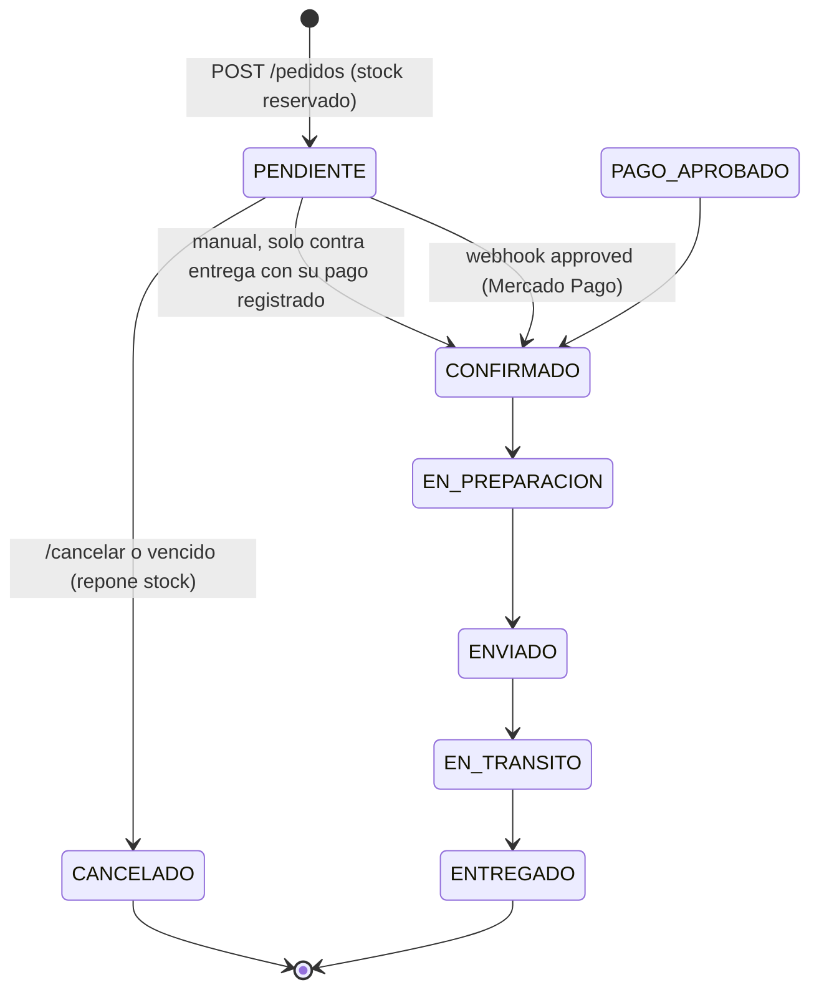

# Estados del pedido, del envío y del pago (MOD-05, MOD-06, MOD-07)

Sprint 4, fase B. Cierra el punto abierto de `docs/diseno/info-envio.md` §7 ("¿cuál es la fuente
de verdad entre `Pedido.estado` e `InfoEnvio.estadoEnvio`?") y documenta las reglas que implementan
`backend/src/services/pedido.service.js` y `backend/src/services/pago.service.js`.

Fuentes: ERS v1.2 §4.2 (estados de un pedido), §4.1 (matriz de roles), RF-019, RF-027 a RF-033,
RN-002, RN-003, RN-006, RN-008, RN-009; DDS v1.2 §3 (MOD-05/06/07), §5.2 y §5.3.

## 1. Fuente de verdad

- **`Pedido.estado` manda** en el ciclo del pedido.
- `InfoEnvio` nace con el pedido en `EN_PREPARACION` (RF-027) y guarda la dirección y el costo de
  envío congelados.
- **Invariante:** mientras el pedido está en `EN_PREPARACION`, `ENVIADO`, `EN_TRANSITO` o
  `ENTREGADO`, `InfoEnvio.estadoEnvio` vale exactamente lo mismo. Los dos se escriben en la **misma
  transacción**, con el lock de la fila del pedido tomado (`SELECT ... FOR UPDATE`).
- Antes de eso (`PENDIENTE`, `CONFIRMADO`...) o si el pedido se cancela, `estadoEnvio` queda en
  `EN_PREPARACION` (el valor de alta) y **no significa que se esté preparando**: el frontend debe
  mostrar `estadoPedido` hasta que el pedido entre en preparación (el seguimiento devuelve ambos).

## 2. Diagrama

## 3. Transiciones manuales (`PATCH /api/v1/pedidos/:id/estado`, admin y vendedor)

Tabla `TRANSICIONES_PEDIDO` de `pedido.service.js`, probada celda por celda en
`backend/tests/pedido.consulta.http.test.js` (las 100 combinaciones).

| Desde \ Hacia | CONFIRMADO | EN_PREPARACION | ENVIADO | EN_TRANSITO | ENTREGADO | resto |
| --- | :---: | :---: | :---: | :---: | :---: | :---: |
| **PENDIENTE** | OK\* | 409 | 409 | 409 | 409 | 409 |
| **PAGO_APROBADO** | OK | 409 | 409 | 409 | 409 | 409 |
| **CONFIRMADO** | 409 | OK | 409 | 409 | 409 | 409 |
| **EN_PREPARACION** | 409 | 409 | OK | 409 | 409 | 409 |
| **ENVIADO** | 409 | 409 | 409 | OK | 409 | 409 |
| **EN_TRANSITO** | 409 | 409 | 409 | 409 | OK | 409 |
| **ENTREGADO, CANCELADO, PAGO_RECHAZADO, PAGO_PENDIENTE** | 409 | 409 | 409 | 409 | 409 | 409 |

\* `PENDIENTE -> CONFIRMADO` a mano solo para **contra entrega** y con el `Pago` contra entrega ya
registrado (`POST /api/v1/pagos/contra-entrega`, estado `PENDIENTE` o `APROBADO`). Un pedido de
Mercado Pago lo confirma únicamente el webhook al aprobarse el pago.

Reglas:

1. Lineal y hacia adelante: sin saltos (`CONFIRMADO -> ENVIADO`), sin retrocesos y sin repetir el
   mismo estado (mismo criterio que `TRANSICIONES_ENVIO`, ver `info-envio.md` §3).
2. `CANCELADO` **no** se fija por `/estado`: solo por `PATCH /api/v1/pedidos/:id/cancelar`, que
   repone el stock.
3. `PENDIENTE` y los estados de pago (`PAGO_APROBADO`, `PAGO_RECHAZADO`, `PAGO_PENDIENTE`) **no** se
   fijan a mano: los maneja `pago.service`.
4. Pasar a un estado de envío actualiza `InfoEnvio` en la misma transacción (con
   `validarTransicionEstado` de `envio.service`). Sin `InfoEnvio` -> 409 `ENVIO_NO_REGISTRADO`.

Errores: estado fuera del enum -> 400 `VALIDACION_FALLIDA`; transición no permitida -> 409
`TRANSICION_ESTADO_INVALIDA`; pedido inexistente -> 404 `PEDIDO_NO_ENCONTRADO`.

## 4. Envío (`PUT /api/v1/pedidos/:id/estado-envio`, admin y vendedor; RF-029)

- Solo si el pedido ya está en un estado de envío (`EN_PREPARACION`..`EN_TRANSITO`); si no
  (`PENDIENTE`, `CONFIRMADO`, `CANCELADO`...) -> 409 `TRANSICION_ENVIO_INVALIDA`. Entrar en
  preparación se hace con `PATCH /estado` (`CONFIRMADO -> EN_PREPARACION`).
- Transición con `validarTransicionEstado` (400 `ESTADO_ENVIO_INVALIDO` / 409
  `TRANSICION_ENVIO_INVALIDA`) y `Pedido.estado` pasa al mismo valor en la misma transacción.
- Es equivalente a `PATCH /estado` con un estado de envío; existe porque el DDS §3 lo define para
  MOD-05.

`GET /api/v1/pedidos/:id/seguimiento` (dueño, admin y vendedor; ajeno -> 404) devuelve
`estadoPedido`, `estadoEnvio`, `actualizadoEn` (fecha y hora del último cambio de envío),
`costoEnvio`, la dirección de entrega (destinatario, teléfono, calle, ciudad...) y `historial`:
los cambios de estado de envío con su fecha y hora, del más antiguo al más reciente
(`{ estadoAnterior, estadoNuevo, creadoEn }`; la primera entrada es el alta, con
`estadoAnterior: null`). Admin y vendedor ven además `usuario: { id, nombre }` de quien hizo cada
cambio; el cliente no ve la identidad del personal. Cada cambio de envío escribe su fila en la
misma transacción que `InfoEnvio` y `Pedido.estado` (alta, `PUT /estado-envio` y `PATCH /estado`
a un estado de envío); cancelar, vencer y el webhook de pagos no tocan el envío. Detalle en
`info-envio.md` §5.

## 5. Quién puede qué (ERS §4.1 y §2.8.3)

La matriz de roles del ERS (§4.1) le da al cliente "Crear pedidos" y "Consultar propios pedidos";
"Gestionar pedidos" (que incluye cancelar) es solo de vendedor y administrador.

| Operación | cliente | vendedor | admin |
| --- | :---: | :---: | :---: |
| Crear pedido (`POST /pedidos`) | ✓ | — | — |
| Listar / ver pedidos | solo los propios | todos | todos |
| Cambiar estado / estado de envío | — | ✓ | ✓ |
| Cancelar (`PATCH /:id/cancelar`) | — (403) | ✓ | ✓ |
| Cancelar vencidos (`POST /pedidos/vencidos/cancelar`) | — | — | ✓ |
| Ver seguimiento | solo los propios | ✓ | ✓ |

Un pedido ajeno responde 404 (no 403) para no revelar que existe (RN-003, DDS §5.2). Una operación
que el rol no tiene responde 403 `ACCESO_DENEGADO` (roleGuard).

### Cancelación por el cliente (RF-033): diferida a v2.0

El ERS v1.2 §2.8.3 difiere RF-033 a la Versión 2.0: en el MVP la cancelación la gestiona
manualmente administración o vendedor a solicitud del cliente (también DDS §3, MOD-06). Por eso
`PATCH /api/v1/pedidos/:id/cancelar` es solo `admin` y `vendedor`. Antes de habilitarla para el
cliente, **RN-010 exige que el negocio defina la política de cancelaciones** (en qué estados, con
qué plazo, qué pasa con el pago) antes de la puesta en producción.

## 6. Invariantes de stock (RN-002, RN-007, RF-019)

- El stock se **descuenta al crear el pedido**, dentro de la transacción que lo crea
  (`descontarPorPedido` con el cliente `tx`): queda **reservado** hasta que el pedido se cancele.
  El webhook de pago no vuelve a descontar (RN-009).
- La creación toma el lock del carrito: dos `POST /pedidos` simultáneos del mismo carrito producen
  exactamente un pedido; el otro recibe 409 `CARRITO_VACIO`.
- Cancelar repone el stock **una sola vez**: la idempotencia sale del estado leído bajo el lock del
  pedido (un pedido ya `CANCELADO` responde 200 `yaCancelado: true` sin reponer), porque
  `reponerPorPedido` no es idempotente.
- Solo se cancelan pedidos `PENDIENTE` (o los legados `PAGO_PENDIENTE` / `PAGO_RECHAZADO`).

## 7. Invariantes de pago

- Un pedido con `Pago` `APROBADO` **nunca** se cancela desde el sistema: 409
  `PEDIDO_NO_CANCELABLE` y log JSON `CANCELACION_RECHAZADA_CON_PAGO_APROBADO`; el reembolso es
  manual.
- Cancelación y webhook `approved` simultáneos se resuelven por el lock del pedido:
  - gana la cancelación -> el `approved` llega sobre `CANCELADO`: `Pago` `APROBADO`, pedido sigue
    `CANCELADO`, 200 `requiereReembolso` y log `PAGO_APROBADO_SOBRE_PEDIDO_CANCELADO`;
  - gana el `approved` -> pedido `CONFIRMADO`; la cancelación responde 409.
- Al cancelar un pedido contra entrega con su `Pago` `PENDIENTE`, el `Pago` pasa a `CANCELADO`. Un
  intento `RECHAZADO` de Mercado Pago queda como está.

## 8. Pedidos vencidos

**Vigencia de pago de un pedido de Mercado Pago:** `creadoEn + V`, con `V` =
`MERCADOPAGO_PREFERENCIA_HORAS` (1..168; 24 si falta o es inválida). La usan los dos lados:

- `pago.service.crearPreferencia`: la preferencia vence en el **menor** entre `ahora + V` y
  `creadoEn + V` (`expiration_date_to` y `date_of_expiration`). Si ya pasó `creadoEn + V` responde
  409 `PEDIDO_VENCIDO` sin llamar a Mercado Pago. Así una preferencia creada a la hora 23 no se
  puede pagar a la hora 25, cuando el pedido ya se canceló y su stock se repuso.
- `pedido.service.cancelarPedidosVencidos`: corta en `creadoEn < ahora - (V' + 15 min)`, con
  `MARGEN_VENCIMIENTO_MS` = 15 minutos (desfase de reloj con Mercado Pago, pago acreditado justo al
  límite).

`POST /api/v1/pedidos/vencidos/cancelar` (admin), body opcional `{ "horas": 1..168 }`. **`horas` es
un piso, no un reemplazo:** `V' = max(horas, V)`. Un valor menor que la vigencia configurada no
tiene efecto (no se cancela un pedido cuya preferencia sigue viva); uno mayor es más conservador y
se respeta. Cancela, con reposición y cada uno en su propia transacción bajo su lock, los pedidos
`MERCADO_PAGO` en `PENDIENTE` vencidos **sin** `Pago` `APROBADO`. Nunca toca contra entrega (se paga
al recibir). Responde `{ horas: V', corte, cancelados: [ids], omitidos: [ids] }`.

Si se **baja** `MERCADOPAGO_PREFERENCIA_HORAS` con preferencias ya emitidas, éstas conservan su
vencimiento original: conviene esperar la vigencia anterior antes de bajarla.

**No hay cron**: un scheduler externo (cron del servidor, tarea programada) debe invocar el
endpoint periódicamente con un token de admin.

## 9. Huecos conocidos

- **Historial de envío (RF-028) y usuario de cada cambio (RF-029): cerrado.** La tabla
  `HistorialEstadoEnvio` existe y el seguimiento devuelve `historial` (ver `info-envio.md` §5). Los
  envíos creados antes de la migración no tienen historial (`historial: []`; sin backfill porque no
  hay datos reales de quién ni cuándo). La notificación al cliente (RF-040) sigue diferida a v2.0.
- **Reembolsos** y **auditoría** (DDS §6.5) se gestionan a mano a partir de los logs JSON.
- **Vendedor por asignaciones** (DDS §6.2, ERS §4.1 "✓\*"): no existe un modelo de asignación;
  hoy un vendedor ve y gestiona todos los pedidos.
- **Retención indefinida de stock** (pendiente de decisión de negocio). Hoy el stock reservado de
  un pedido puede quedar retenido sin límite:
  - los pedidos `CONTRA_ENTREGA` nunca vencen;
  - un contra entrega sin `Pago` registrado no se puede confirmar a mano (queda `PENDIENTE` hasta
    que el personal lo cancele);
  - un contra entrega `CONFIRMADO` que el cliente rechaza en la entrega no se puede cancelar (solo
    se cancelan pedidos pendientes de pago);
  - no hay tope de pedidos `PENDIENTE` por cliente;
  - no hay scheduler: si nadie invoca `/vencidos/cancelar`, tampoco vencen los de Mercado Pago.

  Propuestas: tope de pedidos pendientes por cliente; vencimiento para contra entrega sin
  confirmar; cancelación por el personal de un contra entrega `CONFIRMADO` (rechazado en la
  entrega) con reposición de stock.
- **Momento del descuento de stock**: se descuenta al **crear** el pedido, lo que se desvía del
  DDS §7.2 (descuento al aprobar el pago, paso 13). Es coherente con `pago.service` (el webhook no
  descuenta) y con la política vigente "un rechazo de pago no repone stock": el stock queda
  reservado mientras el pedido siga pagable y se libera al cancelarlo o vencer. Corresponde
  actualizar el DDS.
- **Cobertura y contra entrega fuera de la transacción**: `calcularCosto` y la verificación de
  `permiteContraEntrega` de la zona se evalúan antes de abrir la transacción de creación (para no
  pedir una segunda conexión del pool con el lock del carrito tomado). Si un admin desactiva la
  zona o la contra entrega en esa ventana de milisegundos, el pedido se crea igual. Está mitigado
  porque `registrarContraEntrega` revalida la zona; se podría cerrar del todo leyendo la zona con
  lock dentro de la transacción (un `bloquearZona` con `SELECT ... FOR SHARE`).
